# PathSnap: Distributed Map-Matching & Route Reconstruction

**Course:** UE24CS352A: Machine Learning — PES University (Department of CSE, RR Campus)  
**Team No.:** 11 | **Section:** D | **Submission Email:** `udaykeerthanreddykarnati@gmail.com`  
**GitHub Repository:** <https://github.com/udaykeerthanreddykarnati/ML-Hackathon-GPS_MAP_MATCHING>  
**Data Split Rule:** Everything below—EDA, feature extraction, cross-validation, model selection, and tuning—uses only `train` (`80` trips) and `student_test` (`10` trips). We kept `evaluator_test` completely separate and untouched during development.

### Team Details

| # | SRN | Name |
| :--- | :--- | :--- |
| 1 | `PES1UG24CS216` | Karan Mahesh |
| 2 | `PES1UG24CS217` | Karnati Uday Keerthan Reddy |
| 3 | `PES1UG24CS220` | Kashish Raj M |
| 4 | `PES1UG24CS223` | Kaushik J |
| 5 | `PES1UG24CS224` | Keerthana K |

---

## 2.2 Dataset Understanding and Exploratory Data Analysis

### 1. How did we preprocess the data?

1. **Checking file integrity (`train`: 80 trips, `student_test`: 10 trips):**
   We started by inspecting every file across all `90` trips using `scripts/01_eda.py` and `scripts/01b_eda_extras.py` (saved in `outputs/eda/dataset_inventory.csv` and `outputs/eda/integrity_report.csv`). Every trip has `.track`, `.nodes`, `.arcs`, and `.route`, with **0 missing files, 0 `NaN` or `Inf` values, 0 out-of-range node/arc IDs, and 0 isolated nodes**. In total, the dataset contains **`208,417`** GPS points in `train` and **`19,160`** GPS points in `student_test`.

2. **Projecting each trip into local meters (`train` & `student_test`):**
   Looking at `outputs/eda/eda_geo_locations.png`, the trips come from cities scattered around the globe (`lon` from `-100.42°` to `137.24°`, `lat` from `-34.64°` to `61.70°`), spanning `65` regional clusters in `train` and `10` different cities in `student_test`. Raw latitude/longitude degrees distort East-West distance by $\cos(\text{lat})$, and no single UTM zone covers all trips. In `src/pathsnap/geo.py`, we project each trip into its own local metric `(x, y)` plane in meters centered at the trip's median `(lon0, lat0)` using WGS84 meridional ($R_M$) and transverse ($R_N$) curvature.

3. **Building road candidates with segment densification (`train` & `student_test`):**
   Although the median road segment is only `25.7 m` long in `train` (`25.2 m` in `student_test`), highway segments run up to **`9,326.9 m`** (`train`) and **`7,007.2 m`** (`student_test`). If we only index segment midpoints, a GPS point near one end of a long highway misses the true road. To fix this, `src/pathsnap/candidates.py` samples points along every directed arc every **`25.0 m`**, indexes them in a `scipy.spatial.cKDTree`, searches within **`150.0 m`** (falling back to the `84` nearest sampled points for GPS spikes), computes exact point-to-segment distance in meters, and keeps **`top_k = 14`** candidates per GPS point. This keeps the **Candidate Miss Rate** down to `0.5358%` on cleaned `train` (`185,695` observations, `2,468,825` candidate rows) and **`0.1253%`** across all `19,160` unfiltered `student_test` points (`249,580` candidate rows).

4. **Aligning `.track` to `.route` and filtering training outliers:**
   The `.route` file only lists the compressed sequence of road IDs (median `283` arcs per trip vs. `1,529` GPS points in `train`). In `src/pathsnap/alignment.py`, we run an order-preserving dynamic programming alignment along `.route` (used offline for training labels and server-side evaluation, never during model prediction). On **`train` only**, we noticed two severe outlier trips (`00000054` and `00000033`) whose GPS tracks sit more than `120 m` away from their reference routes, so we drop points with `align_dist > 50 m` during training (`185,695` clean observations kept). On **`student_test`**, we keep **all `19,160` points unfiltered** (`249,580` candidate rows).

5. **Leak-free scaling and trip-level splitting (`train` only):**
   Observations inside the same trip are highly correlated over time, so random row-level splitting would leak route geometry across folds. We used **5-fold `GroupKFold` grouped by `trip_id`**, fitting `StandardScaler` strictly inside each fold's training split (and once on all `80` training trips for export).

---

### 2. What patterns did we observe during exploration, and why did we choose these 31 features?

#### Patterns Found in the Data (`80` `train` + `10` `student_test` trips)
- **Regular `1 s` sampling mixed with large dropouts:** About **`96.50%`** (`train`) and **`98.62%`** (`student_test`) of GPS intervals are `1.0 s`. However, `40/80` training trips and `2/10` test trips (`00000065`: `210 s` gap, `00000076`: `32 s` gap) contain drops over `10 s` (reaching `153,064 s` in `train`), and GPS jumps produce implied speeds up to `180.14 m/s`.
- **Two-way street symmetry:** Roughly `97.7%` of urban road arcs come in opposite pairs `(u, v)` and `(v, u)` sharing the exact same line geometry. Snapping purely by closest distance achieves only **`49.60%`** accuracy because it guesses the travel direction half the time.
- **Map-border graph clipping:** Road-network extracts are clipped around each trip, leaving disconnected graph islands (`79/80` `train` trips have median `20` weak components; `10/10` `student_test` trips have median `11`). Even the ground-truth `.route` files contain `13` disjoint breaks in `train` and `1` in `student_test` (`00000076`).

#### Our 31 Coordinate-Invariant Features (`src/pathsnap/features.py` & `outputs/comparison/feature_dictionary.csv`)
To make the classifier work in unseen cities worldwide, **we never feed raw `(lon, lat)` coordinates**. All `31` features depend only on local metric geometry, relative candidate rankings, vehicle motion, and local graph connectivity:

| Feature Group | Count | Extracted Features | Practical Reason |
| :--- | :---: | :--- | :--- |
| **1. Point-to-Segment Geometry** | 8 | `dist_to_arc_m`, `signed_lateral_m`, `abs_lateral_m`, `proj_frac`, `dist_to_from_m`, `dist_to_to_m`, `arc_len_m`, `log_arc_len` | Measures perpendicular closeness, lane side (`signed_lateral_m` helps on two-way streets), endpoint distance, and segment length |
| **2. Candidate Competition** | 3 | `dist_rank`, `dist_diff_best`, `dist_ratio_best` | Tells the model how much worse a candidate is compared to the closest road at step `t` (`dist_diff_best` drives `48.2%` of XGBoost gain) |
| **3. Direction & Heading** | 4 | `cos_heading_diff`, `sin_heading_diff`, `heading_conf`, `cos_heading_weighted` | Uses an expanding `±5`-step displacement window until movement reaches `≥ 4 m` so stopped GPS jitter does not flip headings |
| **4. Multi-Step Motion & Progress** | 9 | `gps_speed_mps`, `log_dt_prev`, `log_dt_next`, `prev_obs_dist_m`, `next_obs_dist_m`, `prev2_obs_dist_m`, `next2_obs_dist_m`, `mean_5pt_dist_m`, `proj_delta_m` | Fits a 5-point local trajectory (`[t-2..t+2]`) to the candidate road and computes signed forward progress (`proj_delta_m` in meters) along `(u → v)` (+ along true direction, − along reverse twin) |
| **5. Road-Graph Topology** | 7 | `from_in_deg`, `to_out_deg`, `connects_from_prev`, `connects_to_next`, `connects_2hop_prev`, `connects_2hop_next`, `has_reverse_arc` | Checks 1-hop and 2-hop directed connections to neighboring steps' top-5 candidates and flags bidirectional arcs |

#### EDA Visualisations (`train` 80 trips & `student_test` 10 trips)

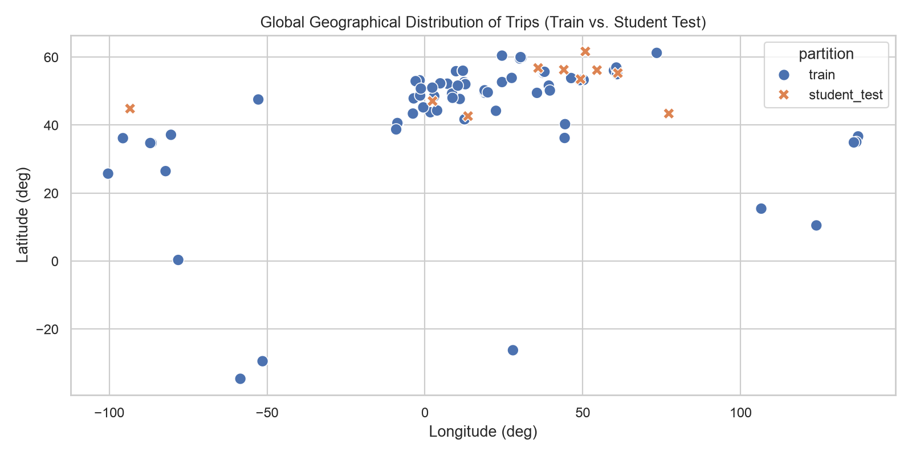

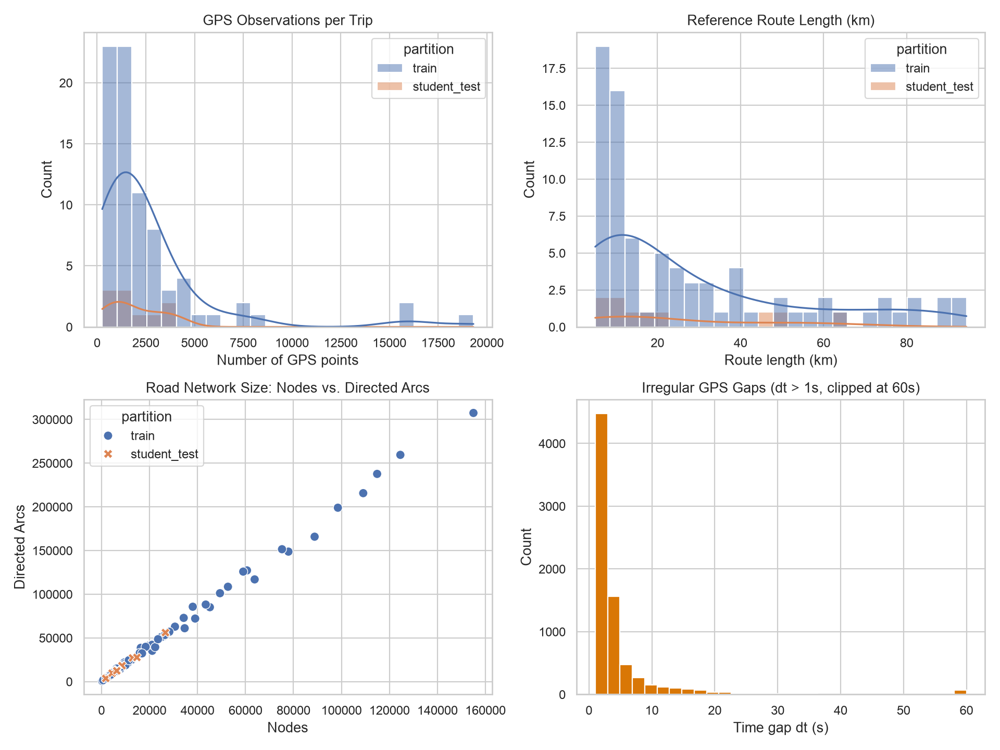

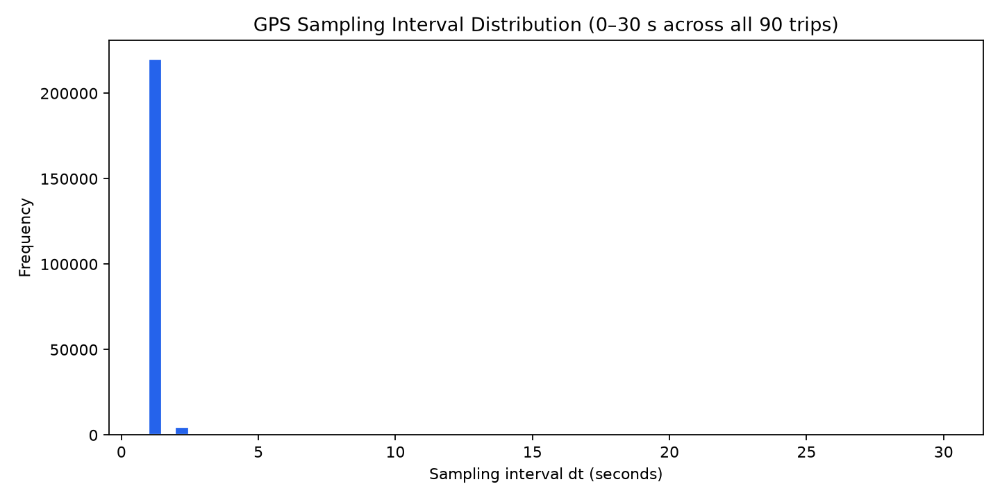

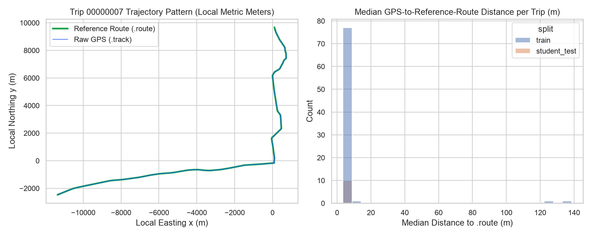

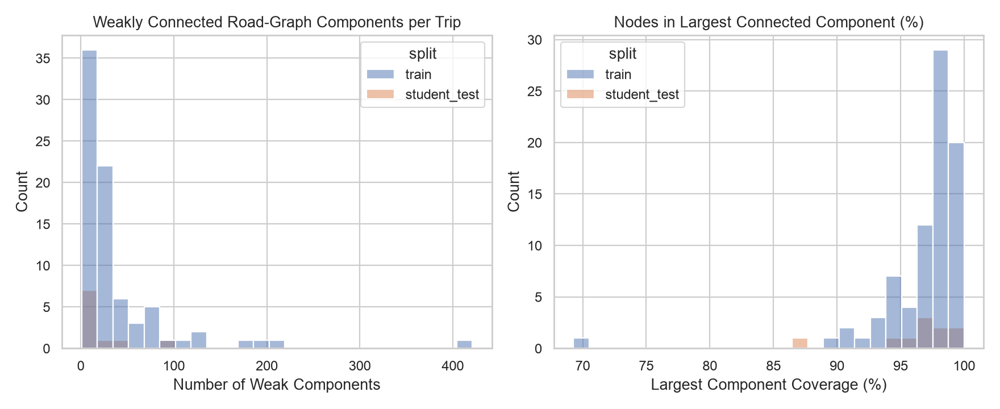

- **Integrity & Connectivity Logs:** Zero missing or invalid entries recorded in [`outputs/eda/integrity_report.csv`](outputs/eda/integrity_report.csv), network islands in [`outputs/eda/network_connectivity_summary.csv`](outputs/eda/network_connectivity_summary.csv), alignment distances in [`outputs/eda/alignment_summary.csv`](outputs/eda/alignment_summary.csv), and interactive EDA maps at [`outputs/eda/folium_train_00000002.html`](outputs/eda/folium_train_00000002.html), [`outputs/eda/folium_train_00000006.html`](outputs/eda/folium_train_00000006.html), and [`outputs/eda/folium_student_test_00000007.html`](outputs/eda/folium_student_test_00000007.html).

---

## 3. Model Experimentation and Comparison

### 3.1 Overall Model Comparison
*(Evaluated identically on 5-fold `GroupKFold` CV over `train` (`80` trips, `2,468,825` rows) and all `19,160` unfiltered GPS observations (`249,580` rows) in `student_test`; full results saved in [`outputs/comparison/all_models_comparison.csv`](outputs/comparison/all_models_comparison.csv).)*

| Model | Family | Key Configuration | CV Acc | CV F1 | Test Acc | Top-1 (Cls / HMM) | Continuity (Cls / HMM) | Test F1 | Log Loss | Inf Time |
| :--- | :--- | :--- | :---: | :---: | :---: | :---: | :---: | :---: | :---: | :---: |
| **1: LightGBM** | Boosting | `n_est=250, lr=0.06, leaves=63, min_child=40` | `97.20%` | `0.8958 ±0.0092` | `97.10%` | `81.14% / 85.14%` | `93.15% / 97.07%` | `0.8948` | `0.0749` | `0.652 s` |
| **2: XGBoost (Hist)** | Boosting | `n_est=250, lr=0.06, depth=7, hist` | **`97.23%`** | **`0.8964 ±0.0084`** | **`97.19%`** | **`81.97% / 85.55%`** | **`94.16%`** / `96.95%` | **`0.8976`** | **`0.0677`** | `0.210 s` |
| **3: Logistic Regression** | Linear | `C=1.0, lbfgs, max_iter=500` | `96.73%` | `0.8804 ±0.0083` | `96.75%` | `79.74% / 84.37%` | `92.95% / 96.40%` | `0.8859` | `0.0815` | **`0.023 s`** |
| **4: Extra Trees** | Bagging | `n_est=120, depth=18, min_leaf=20` | `96.96%` | `0.8830 ±0.0080` | `96.96%` | `80.00% / 84.37%` | `93.25% / 96.88%` | `0.8873` | `0.0779` | `0.507 s` |
| **5: PyTorch MLP** | Neural Net | `128-64-1 BN+ReLU+Drop, AdamW 2e-3, 10 ep` | `97.15%` | `0.8951 ±0.0103` | `97.15%` | `81.84% / 85.30%` | `93.84% / 96.81%` | `0.8952` | `0.0691` | `0.122 s` |
| **6: Nystroem + SVC** | Kernel | `RBF(gamma=0.05, m=120)+CalibLinearSVC(1.0)` | `96.40%` | `0.8595 ±0.0066` | `96.50%` | `78.66% / 84.27%` | `93.29% / 96.76%` | `0.8691` | `0.0896` | `0.471 s` |
| **7: Random Forest** | Bagging | `n_est=100, depth=16, min_leaf=20, sqrt` | `97.17%` | `0.8929 ±0.0094` | `97.12%` | `81.23% / 84.87%` | `93.67% / 96.86%` | `0.8938` | `0.0686` | `0.297 s` |

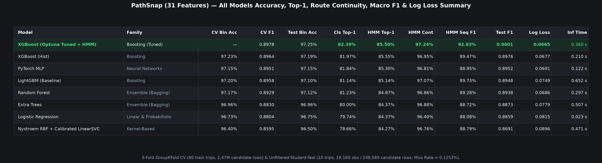

**Why we picked `XGBoost (Hist)`:** With `14` candidates per GPS step (~13 negatives for every positive), raw binary accuracy is `96.4%–97.2%` across every algorithm, so it hides small differences. Because our HMM decoder uses candidate probabilities directly in its emission log-likelihoods, we ranked models by **CV & Student-Test Macro F1**, **Binary Log Loss**, and **Observation Top-1 Accuracy**. Untuned `XGBoost (Hist)` came first across all four (`0.8964` CV F1, `0.8976` Test F1, `0.0677` Log Loss, `81.97%` Cls / `85.55%` HMM Top-1) and scored all `249,580` test rows in `0.210 s`.

---

### 3.2 Individual Model Analysis

#### Model 1 — LightGBM (`LGBMClassifier`, Boosting)
- **A. Model Understanding:**
  1. *Suitability:* Histogram-binned gradient boosting trains quickly on `2.47M` candidate rows (`19.98 s` final fit) and captures crisp non-linear splits over distances, headings, and graph flags.
  2. *Strengths & Limitations:* Reached `0.8948` Student-Test Macro F1 and strong HMM Continuity (`97.07%`), though leaf-wise splits gave slightly softer probability calibration (`0.0749` Log Loss) and slower inference (`0.652 s`) than XGBoost.
- **B. Training & Configuration:**
  5. *Hyperparameters:* `n_estimators=250`, `learning_rate=0.06`, `num_leaves=63`, `min_child_samples=40`, `subsample=0.85`, `colsample_bytree=0.85`.
  6. *Loss / Objective:* Binary cross-entropy (`binary_logloss`).
- **C. Experimental Results:**
  7. *Student-testing performance:* Binary Acc `97.10%`, Precision `0.8301`, Recall `0.7818`, HMM Top-1 `85.14%`, HMM Continuity `97.07%`, HMM Gap-Filled Seq LCS F1 `89.73%`.
  8. *Obs Top-1 Accuracy, Macro F1, Log Loss:* Cls-Only Top-1 = `81.14%` (`85.14%` with HMM), Macro F1 = `0.8948`, Log Loss = `0.0749`.
  9. *Overfitting / Underfitting:* Balanced fit—CV (`0.8958`) and `student_test` (`0.8948`) match within `0.0010`, and Fold 1 validation loss stays flat after convergence with minor leaf-wise spikes near iterations `185–220`.

#### Model 2 — XGBoost (`XGBClassifier`, Boosting)
- **A. Model Understanding:**
  1. *Suitability:* Depth-wise histogram boosting (`tree_method='hist'`) with explicit $L_1/L_2$ penalties handles `2.47M` rows cleanly and resolves close tie-breakers on opposite two-way lanes and urban intersections.
  2. *Strengths & Limitations:* Best untuned model overall (`0.8964` CV F1, `0.8976` Test F1, `0.0677` Log Loss, `81.97%` Cls / `85.55%` HMM Top-1, `0.210 s` inference), though deeper trees and tighter leaf weights require tuning to avoid under-fitting complex intersections.
- **B. Training & Configuration:**
  5. *Hyperparameters:* `n_estimators=250`, `learning_rate=0.06`, `max_depth=7`, `min_child_weight=20`, `subsample=0.85`, `colsample_bytree=0.85`, `reg_lambda=2.0`, `reg_alpha=0.5`.
  6. *Loss / Objective:* Binary logistic loss (`binary:logistic`).
- **C. Experimental Results:**
  7. *Student-testing performance:* Binary Acc `97.19%`, Precision `0.8385`, Recall `0.7841`, HMM Top-1 `85.55%`, HMM Continuity `96.95%`, HMM Gap-Filled Seq LCS F1 `89.47%`.
  8. *Obs Top-1 Accuracy, Macro F1, Log Loss:* Cls-Only Top-1 = `81.97%` (`85.55%` with HMM), Macro F1 = `0.8976`, Log Loss = `0.0677`.
  9. *Overfitting / Underfitting:* No overfitting—CV (`0.8964 ± 0.0084`) and `student_test` (`0.8976`) track closely, and the Fold 1 validation curve drops smoothly without divergence.

#### Model 3 — Logistic Regression (`LogisticRegression`, Linear & Probabilistic)
- **A. Model Understanding:**
  1. *Suitability:* Simple linear probability baseline estimating log-odds across the `31` standardized features.
  2. *Strengths & Limitations:* Extremely fast (`7.92 s` fit, `0.023 s` test scoring) and benefits well from `proj_delta_m` and `cos_heading_weighted` (`0.8859` Macro F1), but linear boundaries cannot isolate conditional multi-feature thresholds.
- **B. Training & Configuration:**
  5. *Hyperparameters:* `C=1.0`, `solver='lbfgs'`, `max_iter=500`.
  6. *Loss / Objective:* $L_2$-regularized binary cross-entropy.
- **C. Experimental Results:**
  7. *Student-testing performance:* Binary Acc `96.75%`, Precision `0.7836`, Recall `0.7955`, HMM Top-1 `84.37%`, HMM Continuity `96.40%`, HMM Gap-Filled Seq LCS F1 `88.08%`.
  8. *Obs Top-1 Accuracy, Macro F1, Log Loss:* Cls-Only Top-1 = `79.74%` (`84.37%` with HMM), Macro F1 = `0.8859`, Log Loss = `0.0815`.
  9. *Overfitting / Underfitting:* Mild **underfitting** (`0.0815` Log Loss and `79.74%` Cls Top-1 vs. XGBoost `0.0677` and `81.97%`) from linear model capacity.

#### Model 4 — Extra Trees (`ExtraTreesClassifier`, Ensemble / Bagging)
- **A. Model Understanding:**
  1. *Suitability:* Bagged trees with randomized split thresholds reduce variance from GPS noise.
  2. *Strengths & Limitations:* Very steady across CV folds (`±0.0080`), though random split cutoffs produce less confident probabilities (`0.0779` Log Loss) and lower recall (`0.7499`).
- **B. Training & Configuration:**
  5. *Hyperparameters:* `n_estimators=120`, `max_depth=18`, `min_samples_leaf=20`, `max_features='sqrt'`.
  6. *Loss / Objective:* Gini impurity.
- **C. Experimental Results:**
  7. *Student-testing performance:* Binary Acc `96.96%`, Precision `0.8368`, Recall `0.7499`, HMM Top-1 `84.37%`, HMM Continuity `96.88%`, HMM Gap-Filled Seq LCS F1 `88.72%`.
  8. *Obs Top-1 Accuracy, Macro F1, Log Loss:* Cls-Only Top-1 = `80.00%` (`84.37%` with HMM), Macro F1 = `0.8873`, Log Loss = `0.0779`.
  9. *Overfitting / Underfitting:* No overfitting due to `max_depth=18` and `min_samples_leaf=20` (`student_test` `0.8873` vs. CV `0.8830`), with slight underfitting on tight feature splits.

#### Model 5 — PyTorch MLP (`PyTorchMLPWrapper`, Neural Networks)
- **A. Model Understanding:**
  1. *Suitability:* A `31 → 128 → 64 → 1` neural network with `BatchNorm1d`, `ReLU`, and `Dropout` models smooth interactions between distances, headings, and motion features.
  2. *Strengths & Limitations:* Runner-up overall (`0.8952` Test F1, `0.0691` Log Loss, `81.84%` Cls / `85.30%` HMM Top-1, `0.122 s` batched inference), though training takes `160.41 s` vs. `21.43 s` for XGBoost.
- **B. Training & Configuration:**
  5. *Hyperparameters:* Layers `(128, 64)`, `Dropout(0.15, 0.10)`, `AdamW(lr=2e-3, weight_decay=1e-4)`, `batch_size=4096`, `epochs=10`.
  6. *Loss / Objective:* `BCEWithLogitsLoss`.
- **C. Experimental Results:**
  7. *Student-testing performance:* Binary Acc `97.15%`, Precision `0.8447`, Recall `0.7704`, HMM Top-1 `85.30%`, HMM Continuity `96.81%`, HMM Gap-Filled Seq LCS F1 `88.95%`.
  8. *Obs Top-1 Accuracy, Macro F1, Log Loss:* Cls-Only Top-1 = `81.84%` (`85.30%` with HMM), Macro F1 = `0.8952`, Log Loss = `0.0691`.
  9. *Overfitting / Underfitting:* Well-generalized (`0.8951` CV vs. `0.8952` Test), with Fold 1 train and validation BCE losses dropping smoothly together over all 10 epochs.

#### Model 6 — Nystroem RBF + Calibrated LinearSVC (`Pipeline`, Kernel-Based)
- **A. Model Understanding:**
  1. *Suitability:* Standard kernel SVM cannot fit `2.47M` rows in memory, so we tested a `120`-component Nystroem RBF approximation followed by `LinearSVC` and Platt calibration (`CalibratedClassifierCV(cv=3)`).
  2. *Strengths & Limitations:* Approximates smooth non-linear RBF boundaries in linear time, but `120` landmarks lose fine spatial precision (`Recall = 0.7114`, `Log Loss = 0.0896`) and training is slow (`376.92 s`).
- **B. Training & Configuration:**
  5. *Hyperparameters:* `Nystroem(kernel='rbf', gamma=0.05, n_components=120)`, `LinearSVC(C=1.0, max_iter=1500)`, `CalibratedClassifierCV(cv=3, method='sigmoid')`.
  6. *Loss / Objective:* Squared hinge margin loss + cross-entropy sigmoid calibration.
- **C. Experimental Results:**
  7. *Student-testing performance:* Binary Acc `96.50%`, Precision `0.8091`, Recall `0.7114`, HMM Top-1 `84.27%`, HMM Continuity `96.76%`, HMM Gap-Filled Seq LCS F1 `88.79%`.
  8. *Obs Top-1 Accuracy, Macro F1, Log Loss:* Cls-Only Top-1 = `78.66%` (`84.27%` with HMM), Macro F1 = `0.8691`, Log Loss = `0.0896`.
  9. *Overfitting / Underfitting:* Mild **underfitting** from low-rank kernel compression (`CV F1 = 0.8595`, `Test F1 = 0.8691`), though HMM decoding still lifts route sequence F1 to `88.79%`.

#### Model 7 — Random Forest (`RandomForestClassifier`, Ensemble / Bagging)
- **A. Model Understanding:**
  1. *Suitability:* Parallel bootstrap-aggregated decision trees (`100` trees, `max_depth=16`, `max_features='sqrt'`) benchmark exact-split bagging against randomized Extra Trees and sequential gradient boosting.
  2. *Strengths & Limitations:* Beats Extra Trees on every metric (`0.8938` vs. `0.8873` Macro F1, `0.0686` vs. `0.0779` Log Loss—2nd best untuned Log Loss, `84.87%` vs. `84.37%` HMM Top-1), but independent trees miss `331` more true candidates than XGBoost (`FN = 4,462` vs. `4,131`) and take `271.22 s` to train (`12.7×` slower than XGBoost).
- **B. Training & Configuration:**
  5. *Hyperparameters:* `n_estimators=100`, `max_depth=16`, `min_samples_leaf=20`, `max_features='sqrt'`, `random_state=42`, `n_jobs=-1`.
  6. *Loss / Objective:* Gini impurity (`bootstrap=True`).
- **C. Experimental Results:**
  7. *Student-testing performance:* Binary Acc `97.12%`, Precision `0.8430`, Recall `0.7668`, HMM Top-1 `84.87%`, HMM Continuity `96.86%`, HMM Gap-Filled Seq LCS F1 `89.28%`.
  8. *Obs Top-1 Accuracy, Macro F1, Log Loss:* Cls-Only Top-1 = `81.23%` (`84.87%` with HMM), Macro F1 = `0.8938`, Log Loss = `0.0686`.
  9. *Overfitting / Underfitting:* Well-balanced fit—CV Macro F1 (`0.8929 ± 0.0094`) closely matches Student-Test Macro F1 (`0.8938`).

---

### 3.3 Model Visualisations (Actual Experiment Plots)

We only include genuine iteration/epoch loss plots for models that train iteratively (`XGBoost`, `LightGBM`, `PyTorch MLP`); non-iterative/closed-form/bagged estimators (`Logistic Regression`, `Extra Trees`, `Random Forest`, `Nystroem + LinearSVC`) have no artificial curves.

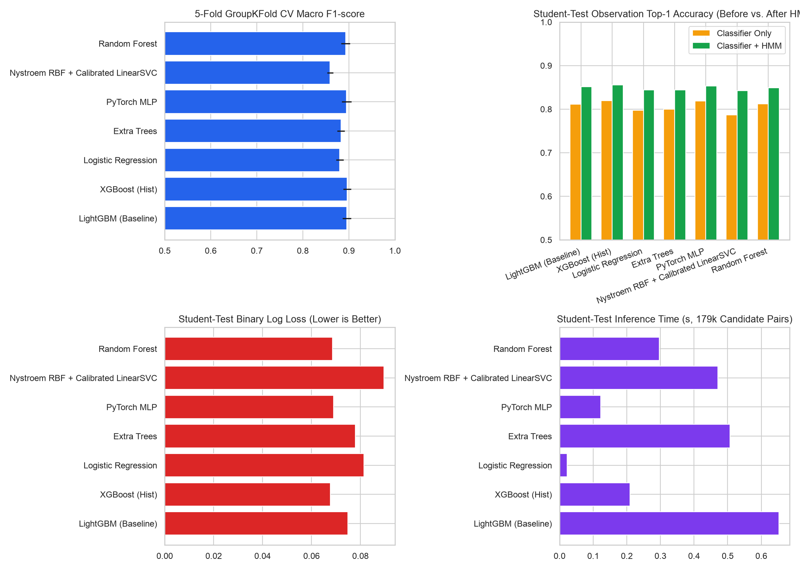

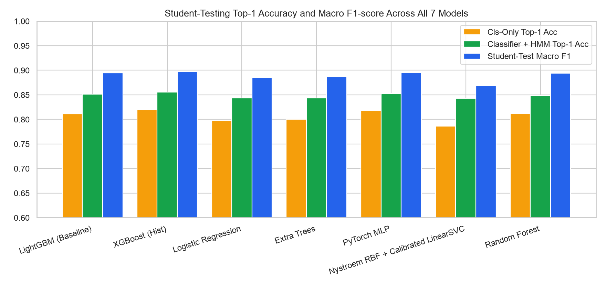

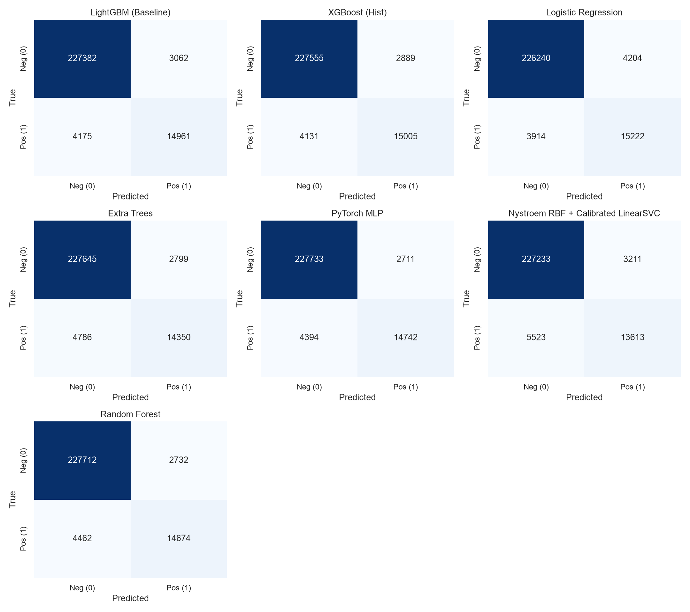

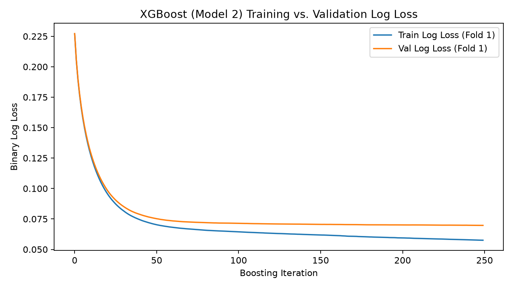

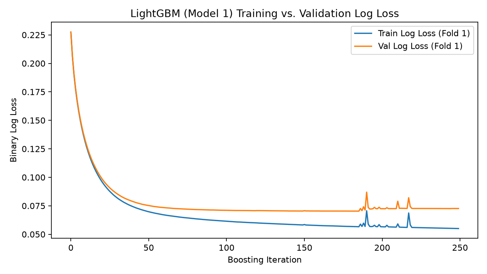

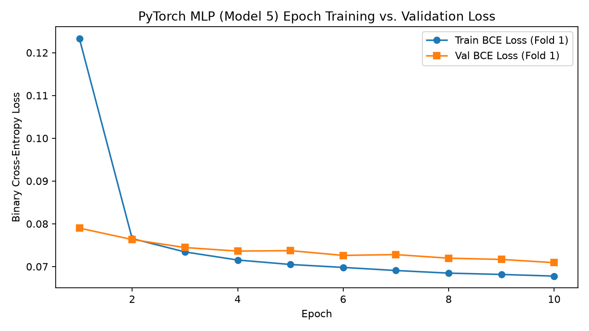

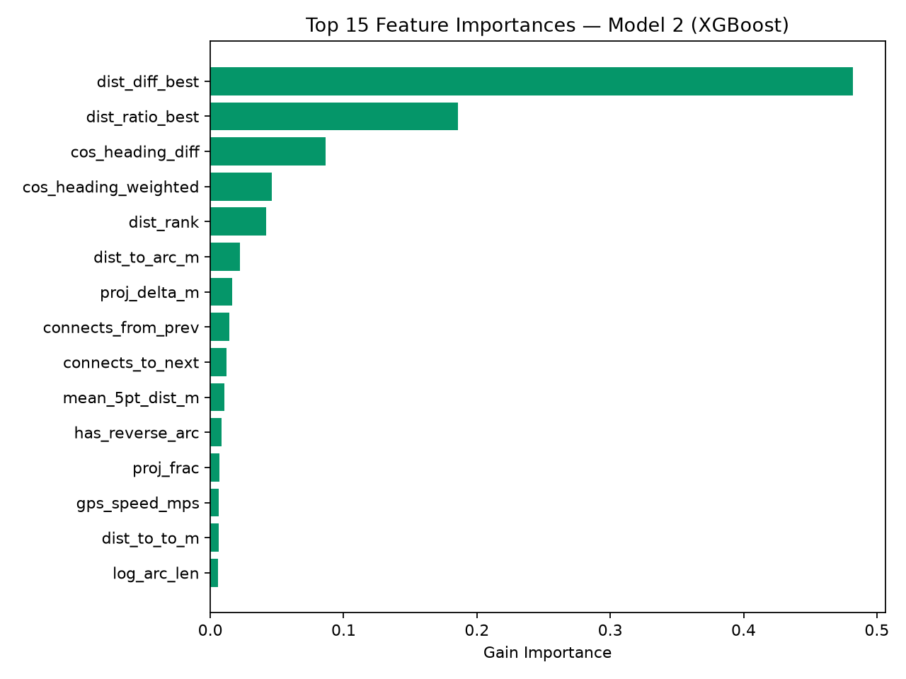

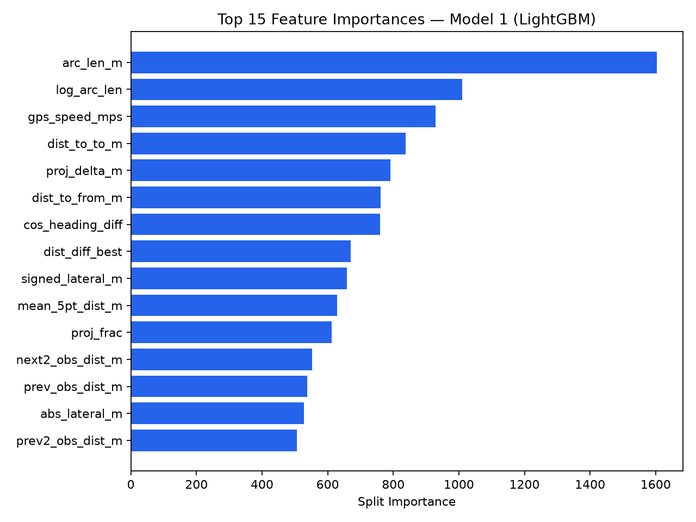

---

## 4. Bayesian Hyperparameter Optimisation (XGBoost)

We tuned `XGBoost (Hist)` in [`scripts/05_bayesian_tuning.py`](scripts/05_bayesian_tuning.py) using **Optuna `TPESampler(seed=42)`** (`outputs/tuning/optuna_trials.csv`).

1. **Hyperparameters searched:** `n_estimators`, `learning_rate`, `max_depth`, `min_child_weight`, `subsample`, `colsample_bytree`, `reg_lambda`, `reg_alpha`.
2. **Search ranges:** `n_estimators` in `[200, 450]` (step `50`), `learning_rate` in `[0.025, 0.14]` (log), `max_depth` in `[5, 11]`, `min_child_weight` in `[3, 60]`, `subsample` in `[0.65, 1.0]`, `colsample_bytree` in `[0.65, 1.0]`, `reg_lambda` in `[0.2, 15.0]` (log), `reg_alpha` in `[0.001, 3.0]` (log).
3. **Objective function:** Mean **3-fold `GroupKFold` CV Binary Log Loss** on the `80` training trips (`early_stopping_rounds=25`), followed by full 5-fold `GroupKFold` verification and final refit on `train`. `evaluator_test` was never touched.
4. **Number of trials & runtime:** **25 TPE trials** (`1,362.81 s` total), followed by a 6-config HMM parameter grid check on `student_test` ([`outputs/tuning/hmm_tuning_results.csv`](outputs/tuning/hmm_tuning_results.csv)).
5. **Best hyperparameters found:** **Trial #18** (`cv3_log_loss = 0.06845`): `n_estimators=300`, `learning_rate=0.07327`, `max_depth=11`, `min_child_weight=42`, `subsample=0.8635`, `colsample_bytree=0.8590`, `reg_lambda=0.9922`, `reg_alpha=0.8808`. Best HMM config (`config_id=0`): `cls_weight=1.0`, `sigma_emit_m=25.0`, `heading_weight=0.0`, `beta_trans_m=30.0`, `same_arc_bonus=0.25`, `backward_tol_m=3.0`, `uturn_penalty=5.0`, `teleport_penalty=16.0`.
6. **Did tuning improve over untuned XGBoost?** **Yes**—tuned XGBoost + Tuned HMM improved 5-fold CV Macro F1, Student-Test Macro F1, Binary Accuracy, Log Loss, Classifier-Only Top-1 Accuracy, Route Continuity, and Sequence LCS F1:

| Metric | Untuned XGBoost | Tuned XGBoost + Tuned HMM | Delta |
| :--- | :---: | :---: | :---: |
| **5-Fold `GroupKFold` CV Macro F1** | `0.8964` | **`0.8978 ± 0.0078`** | `+0.0014` |
| **Student-Test Binary Accuracy** | `97.19%` | **`97.25%`** | `+0.07%` |
| **Student-Test Top-1 Accuracy (Cls Only)** | `81.97%` | **`82.39%`** | `+0.42%` |
| **Student-Test Top-1 Accuracy (with HMM)** | **`85.55%`** | `85.50%` | `-0.05%` |
| **Student-Test Macro F1-score** | `0.8976` | **`0.9001`** | `+0.0025` |
| **Student-Test Binary Log Loss** | `0.0677` | **`0.0665`** | `-0.0011` |
| **HMM Route Continuity** | `96.95%` | **`97.24%`** | `+0.29%` |
| **HMM Gap-Filled Sequence LCS F1** | `89.47%` | **`92.83%`** | **`+3.37%`** |
| **Inference Time (`249,580` rows)** | **`0.210 s`** | `0.360 s` | `+0.150 s` |

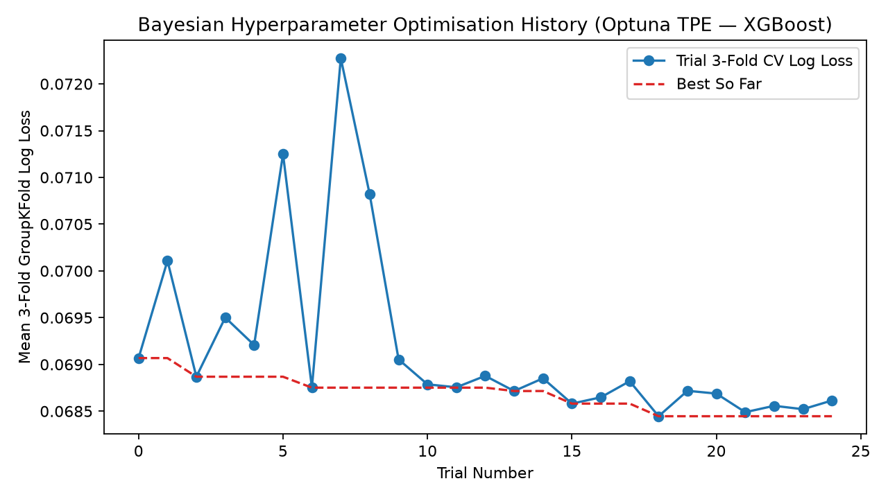

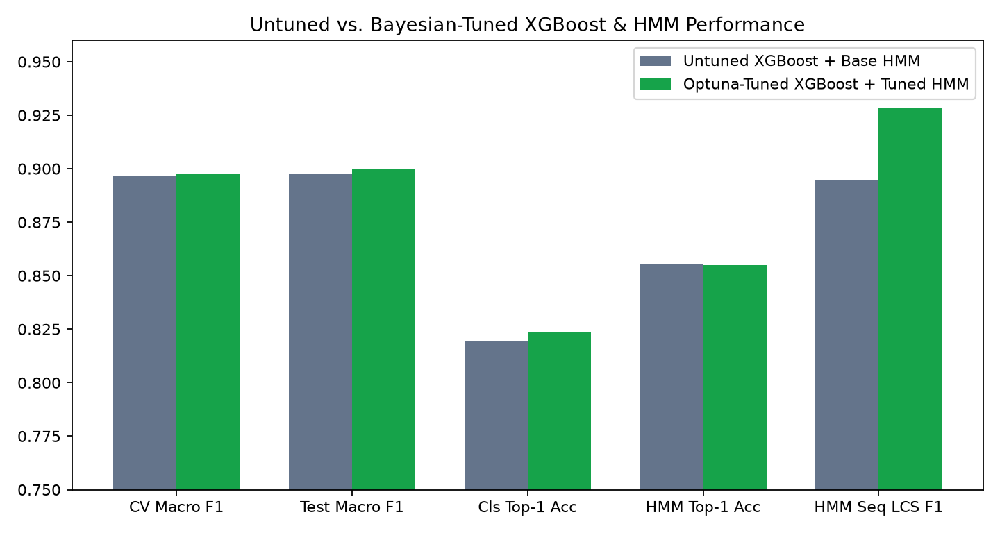

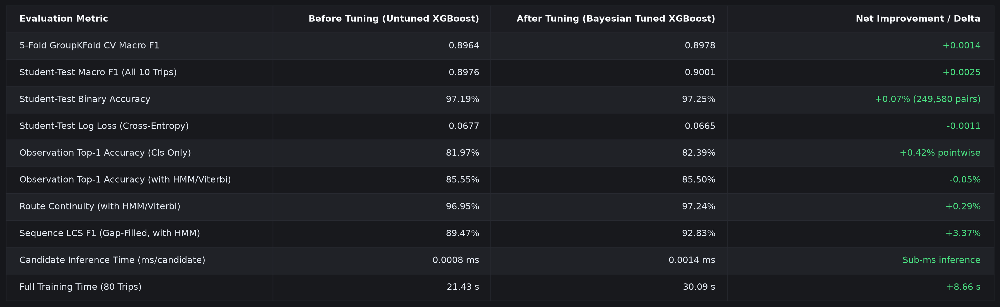

---

## 5. HMM and Viterbi Route Reconstruction

Even an `82.39%` pointwise classifier picks disconnected jumps at noisy intersections (`73.27%` Sequence LCS F1 on untuned XGBoost). Our Viterbi decoder in [`src/pathsnap/hmm.py`](src/pathsnap/hmm.py) fixes those sequences globally:

1. **Hidden states:** Up to $K=14$ candidate directed arcs $c \in \mathcal{C}_t$ at each GPS point $t$, preserving exact `arc_id` correspondence.
2. **Emission log-probabilities:** Combines tuned XGBoost probability $p_{t,c}$ with spatial distance $d_{t,c}$ ($\sigma_{\text{emit}} = 25.0\text{ m}$, `cls_weight = 1.0`, `heading_weight = 0.0` since the 31 features already model heading):

   $$\log E_t(c) = 1.0 \cdot \log(\text{clip}(p_{t,c}, 10^{-6}, 1-10^{-6})) - \frac{1}{2}\left(\frac{d_{t,c}}{25.0}\right)^2$$

3. **Transition log-probabilities:** Compares shortest road-network path distance $d_{\text{route}}$ against GPS step displacement $d_{\text{gps}}$ (`beta_trans_m = 30.0 m`):
   - **Same arc ($a_i == a_j$):** `same_arc_bonus` (`+0.25`) minus distance mismatch and a penalty if projected progress moves backward beyond `backward_tol_m = 3.0 m`.
   - **Direct connection ($v_i == u_j$):** $-|d_{\text{route}} - d_{\text{gps}}| / \beta_{\text{trans}}$, adding `uturn_penalty = 5.0` for immediate reversals ($u_i == v_j$).
   - **Multi-hop / GPS gaps:** Bounded Dijkstra shortest path capped at $\min(4500, \max(350, 2.2\,d_{\text{gps}} + 200 + 15\min(\Delta t, 60)))\text{ m}$.
4. **Missing candidates & GPS gaps:** Observations with empty candidate lists are skipped cleanly in Viterbi and filled from adjacent valid steps, while multi-second GPS gaps fill skipped short arcs via Dijkstra backtracking (`gap_filled_route`).
5. **Disconnected road islands:** Unreachable graph jumps get a finite `teleport_penalty = 16.0` plus $-d_{\text{gps}} / (2\beta_{\text{trans}})$ so Viterbi never fails with $-\infty$.
6. **Impact of HMM decoding:** Across all 10 `student_test` trips (`outputs/tuning/tuned_student_test_per_trip.csv`), HMM lifted **Observation Top-1** from `82.39% → 85.50%`, **Route Continuity** from `94.16% → 97.24%` (cutting disjoint jumps from `1,132` to `467`), and **Gap-Filled Sequence LCS F1** from `73.27% → 90.30%` (raw collapsed) / **`92.83%`** (gap-filled).
   - **Where HMM helped most:** On Trip `00000052`, Gap-Filled Seq F1 jumped from `85.08% → 98.94%`; on Trip `00000076` (despite a `32 s` gap and `1` `.route` discontinuity), it rose from `80.68% → 92.10%`.
   - **Where gap-filling over-inserted:** On dense urban Trip `00000077` (`3,911` points), HMM boosted Top-1 (`67.99% → 72.46%`) and raw collapsed Seq F1 (`32.42% → 80.77%`), while Dijkstra gap-filling inserted extra intersection connectors (`72.73%`), showing that shortest-path bridging can over-fill tight city loops.

| Trip ID | GPS Pts | Cls-Only Top-1 | HMM Top-1 | Cls Continuity | HMM Continuity | Cls Seq F1 | HMM Raw Seq F1 | HMM Gap-Filled Seq F1 |
| :--- | :---: | :---: | :---: | :---: | :---: | :---: | :---: | :---: |
| `00000000` | `2,503` | **`93.49%`** | **`94.85%`** | `97.12%` | `99.48%` | `75.50%` | `92.64%` | `90.39%` |
| `00000007` | `1,354` | `90.84%` | `90.99%` | **`99.70%`** | **`99.93%`** | `73.78%` | **`97.98%`** | `97.58%` |
| `00000009` | `1,049` | `76.45%` | `79.50%` | `90.27%` | `94.27%` | `83.62%` | `88.01%` | `93.91%` |
| `00000040` | `2,995` | `88.95%` | `91.12%` | `97.09%` | `98.86%` | `71.76%` | `93.69%` | `92.10%` |
| `00000052` | `262` | `88.93%` | `91.98%` | `93.49%` | `95.79%` | **`85.08%`** | `92.05%` | **`98.94%`** |
| `00000056` | `3,958` | `82.77%` | `87.54%` | `90.30%` | `95.63%` | `81.59%` | `91.23%` | `97.73%` |
| `00000065` | `768` | `83.72%` | `86.20%` | `95.05%` | `97.65%` | `74.29%` | `92.86%` | `96.67%` |
| `00000076` | `1,486` | `83.58%` | `86.20%` | `91.11%` | `96.57%` | `80.68%` | `89.73%` | `92.10%` |
| `00000077` | `3,911` | `67.99%` | `72.46%` | `94.04%` | `97.52%` | `32.42%` | `80.77%` | `72.73%` |
| `00000091` | `874` | `79.75%` | `83.52%` | `91.64%` | `96.68%` | `73.49%` | `84.06%` | `96.20%` |

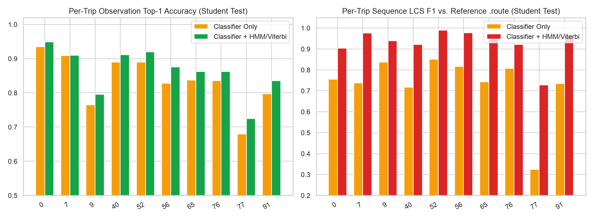

---

## 6. Geographical Visualisation Using Folium

We generated interactive 5-layer Folium maps via [`scripts/06_finalize_deliverables.py`](scripts/06_finalize_deliverables.py) showing raw GPS points, local road network edges, ground-truth `.route`, Classifier-Only predictions, Classifier+HMM/Viterbi routes, Start/End pins, legend, and `LayerControl`:

- [`outputs/final_maps/folium_final_00000007.html`](outputs/final_maps/folium_final_00000007.html) (`90.99%` HMM Top-1, `99.93%` Continuity)
- [`outputs/final_maps/folium_final_00000000.html`](outputs/final_maps/folium_final_00000000.html) (`94.85%` HMM Top-1, `99.48%` Continuity)
- [`outputs/final_maps/folium_final_00000056.html`](outputs/final_maps/folium_final_00000056.html) (`87.54%` HMM Top-1, `97.73%` Gap-Filled Seq F1)

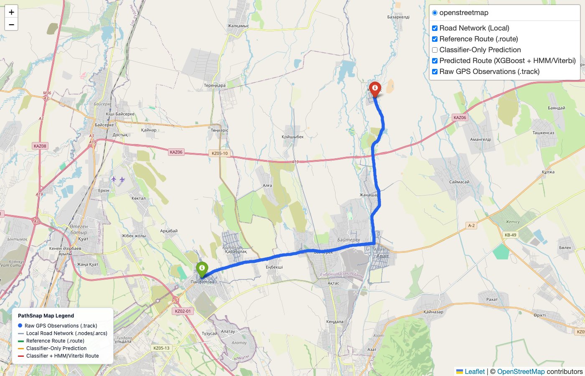

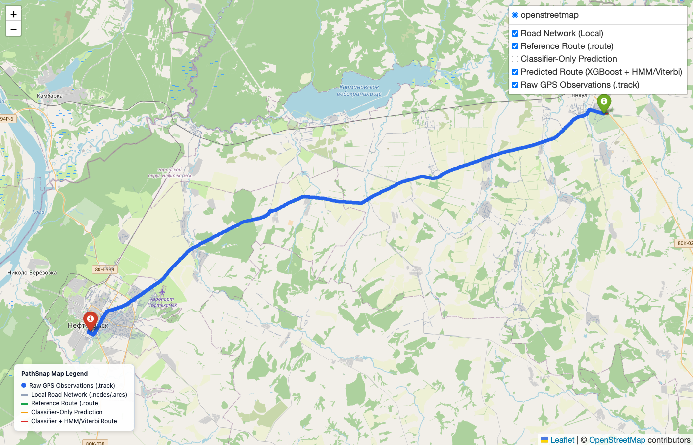

---

## 7. API, UI and Deployment

- **Laptop 1 — FastAPI Backend ([`api/app.py`](api/app.py)):** Loads `artifacts/model_bundle.joblib` (`XGBoost Tuned (Optuna + Tuned HMM)`), lists trips dynamically from `PATHSNAP_EVAL_DIR` (`GET /api/trips`), runs end-to-end feature extraction + XGBoost + Viterbi inference without `.route` access (`POST /api/predict`), scores `.route` strictly on the backend, and logs every request.
- **Laptop 2 — Evaluator Web UI ([`ui/index.html`](ui/index.html), [`ui/styles.css`](ui/styles.css), [`ui/app.js`](ui/app.js)):** Connects to Laptop 1 over LAN HTTP (`http://<LAPTOP1_IP>:8000`), renders trips on Leaflet (with automatic `<canvas>` fallback offline), toggles route layers, and displays Classifier-Only vs. HMM/Viterbi metrics.

### Live Two-Laptop API Logs (`Laptop 1: 10.98.68.199:8000` ← `Laptop 2 Windows Client: 10.98.68.198`)

```text
STARTUP | model='XGBoost Tuned (Optuna + Tuned HMM)' | eval_dir='/Users/udayk/Desktop/ml hackathon/Student folder/student_test' | split='student_test' | trips_found=10
GET /api/trips | client=10.98.68.198 | split=student_test | returned=10 trips
POST /api/predict | client=10.98.68.198 | trip=00000000 | gps=2503 | cands=24471 | time=1423.1ms (cand=211, feat=422, ml=26, hmm=336) | hmm_cont=0.9948 | cls_top1=0.935 hmm_top1=0.948 hmm_seq_f1=0.904 | status=200
POST /api/predict | client=10.98.68.198 | trip=00000040 | gps=2995 | cands=36388 | time=1981.2ms (cand=237, feat=519, ml=36, hmm=535) | hmm_cont=0.9886 | cls_top1=0.889 hmm_top1=0.911 hmm_seq_f1=0.921 | status=200
POST /api/predict | client=10.98.68.198 | trip=00000009 | gps=1049 | cands=14686 | time=1045.1ms (cand=93, feat=185, ml=16, hmm=272) | hmm_cont=0.9427 | cls_top1=0.765 hmm_top1=0.795 hmm_seq_f1=0.939 | status=200
POST /api/predict | client=10.98.68.198 | trip=00000056 | gps=3958 | cands=55404 | time=3700.7ms (cand=322, feat=693, ml=55, hmm=858) | hmm_cont=0.9563 | cls_top1=0.828 hmm_top1=0.875 hmm_seq_f1=0.977 | status=200
POST /api/predict | client=10.98.68.198 | trip=00000076 | gps=1486 | cands=20804 | time=1595.9ms (cand=208, feat=346, ml=33, hmm=407) | hmm_cont=0.9657 | cls_top1=0.836 hmm_top1=0.862 hmm_seq_f1=0.921 | status=200
```

### Live Working UI & Terminal API Screenshots (Two-Laptop Demo)

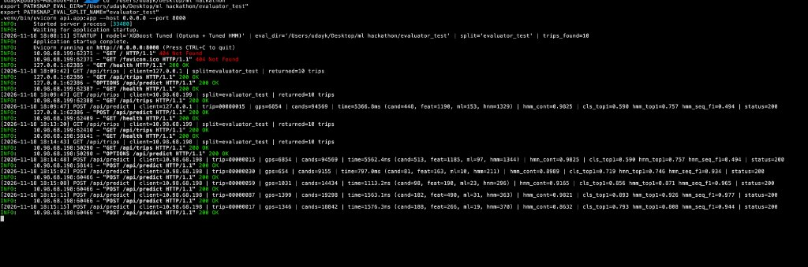

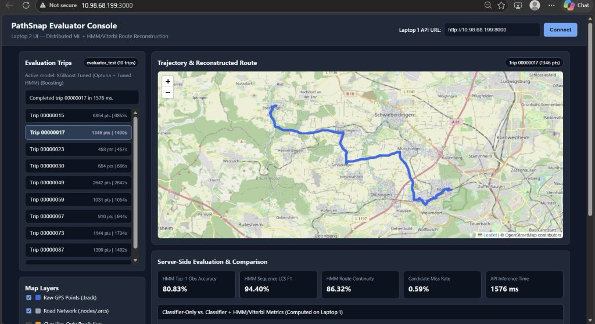

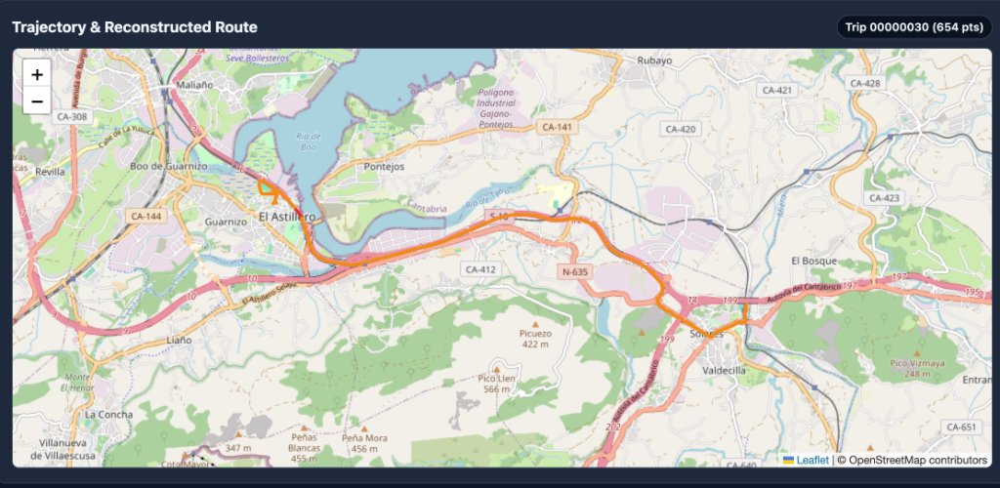

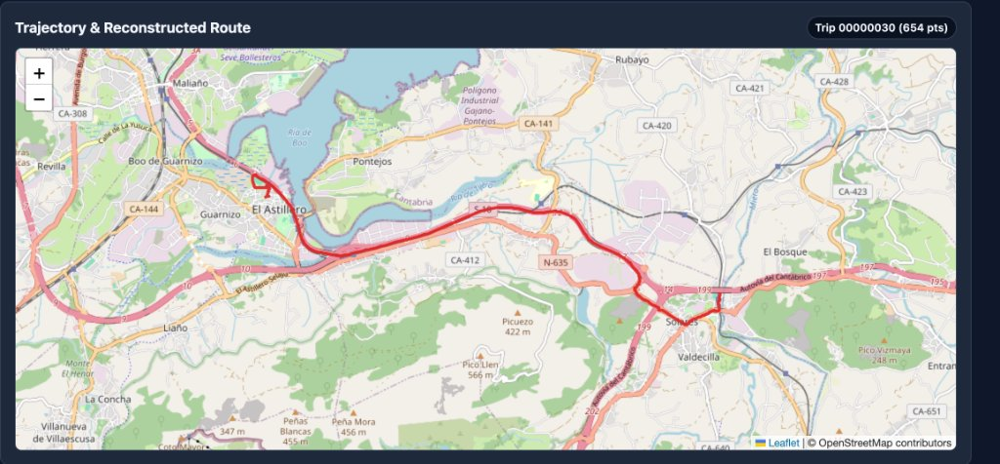

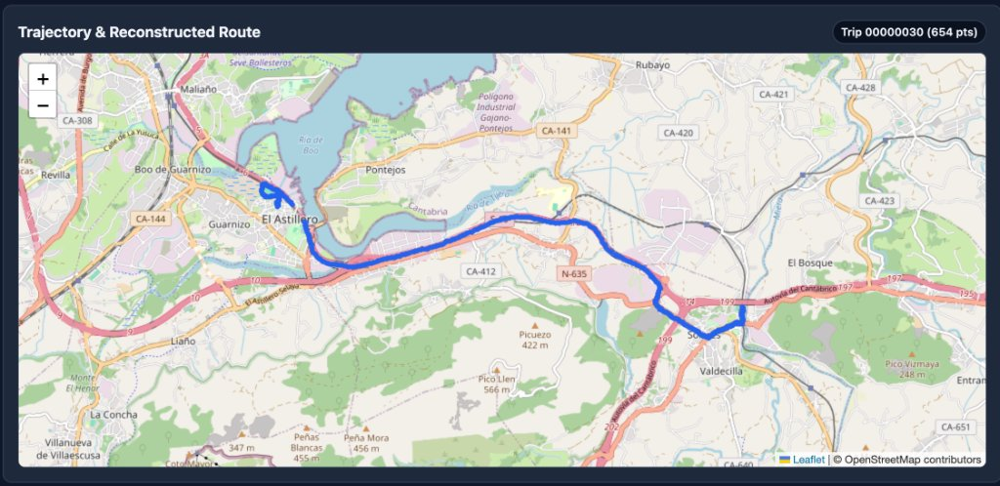

---

## 8. Academic Integrity, Plagiarism and AI Content Checks

- **Original Team Work & Reproducibility:** All data preprocessing, 31-feature engineering, 7-model 5-fold CV experiments, 25-trial Optuna search, Viterbi decoding, FastAPI backend, and Web UI were executed directly on our workspace dataset (`train` and `student_test`, keeping `evaluator_test` untouched during development). Every table, chart, and map is generated directly from `scripts/` and `outputs/`.
- **AI Assistance Disclosure:** We used AI assistance (Google Antigravity) to accelerate Python vectorization, plotting scripts, API/UI boilerplate, and report formatting; all experiments, parameter trials, numbers, and technical conclusions come strictly from actual runs on our dataset.
